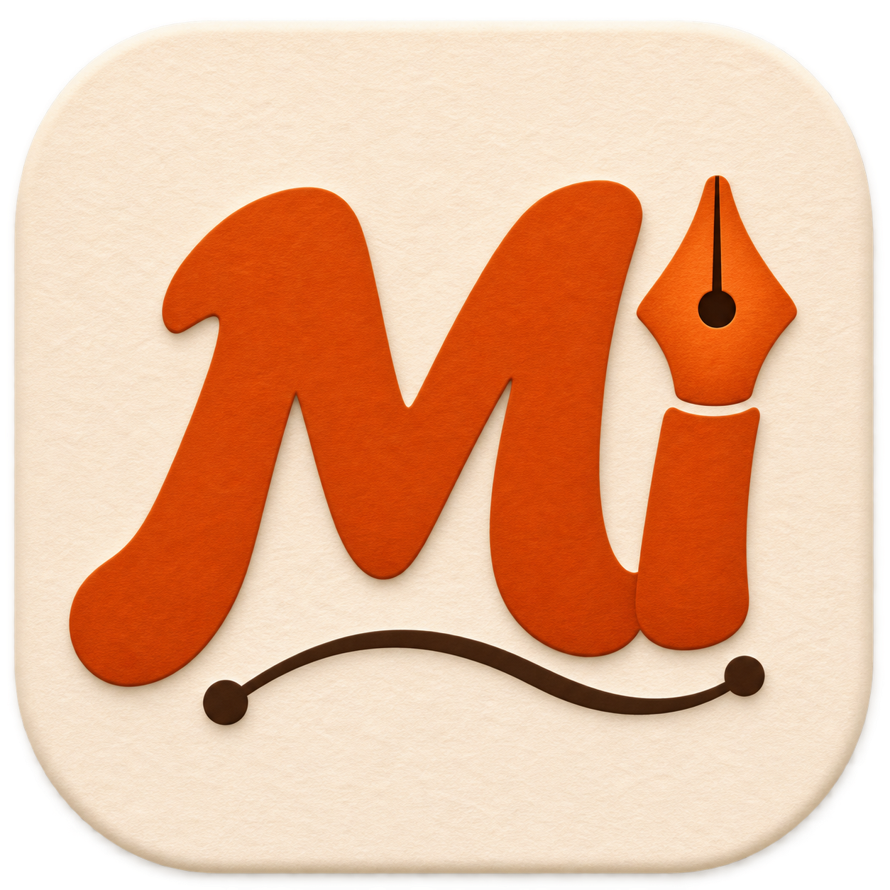

# Magdobe Illustrator



[](https://github.com/d5dtgpt59z-cell/magdobe-illustrator/actions/workflows/macos.yml)

A native macOS vector editor, built from scratch with SwiftUI, AppKit, and Core Graphics. Version 0.6 adds finer image-to-vector tracing and direct preview SVG export alongside freehand Pencil, editable brushes, real groups and nested layers, and a signed-in Codex workflow. It uses original source code and no Adobe binaries or assets. Open source under the [MIT license](LICENSE).

## Open the app

The built application is `dist/Magdobe Illustrator.app`. On launch, choose **New Document** or open an existing `.mvector` project.

Requirements: macOS 14+, Xcode with a Swift 6 toolchain, and Python 3.9–3.14 with `venv`/`pip` (3.11 recommended). The first app build downloads the two pinned vector-conversion packages. Codex is optional for manual drawing and SVG export; generation requires an installed Codex CLI with an existing ChatGPT sign-in.

```sh
git clone https://github.com/d5dtgpt59z-cell/magdobe-illustrator.git
cd magdobe-illustrator
```

Build and launch from this directory:

```sh
./script/build_and_run.sh
```

The script stages a local `.app`, signs it for local use, and launches it. Pass `--build-only` to update the bundle without restarting an active document session. It uses installed Xcode when available without changing the system developer-tool selection. macOS 14 or later is required. The native editor has no third-party Swift package dependencies. The build script installs a local Python environment with VTracer 0.6.15 and svgpathtools 1.8.0 for vector conversion. The project-local Codex Run action calls this script.

For a new runtime, set `MAGDOBE_PYTHON=python3.11` before building if the default `python3` is too new. Existing supported runtimes are reused. Setup rejects Python 3.15+, which crashed the pinned tracer in CI; CI uses Python 3.11.

## Draw with Codex

Click **Draw with Codex** in the toolbar, or press **Shift-Command-G**. Describe your artwork, choose the image style, composition, and vector detail, then click **Generate Editable Artwork**. Compare **Editable vectors** with **Source image**, then **Add to Canvas**. Insertion is one undoable action; a blank document adopts the generated image size, while an existing document fits the new artwork inside its artboard.

Generation uses the installed Codex CLI App Server and your existing ChatGPT sign-in. It does not require an API key. Codex must be installed and signed in, and image generation must be available for the account. The account's image generation limits apply. An optional reference image is sent with the prompt to Codex. **Check Connection** checks the existing login without exposing or copying credentials.

**Vectorize an Existing Image** converts a PNG, JPEG, or WebP locally. This does not require a Codex connection. Vectorization approximates shading with colored Bézier contours, simplifying fine texture and outlining text. **Detailed** is the default. **Ultra** preserves smaller accents and finer color transitions but can produce tens of thousands of objects and much larger files.

Choose a detail setting and **Rebuild Last Image** to retrace the last completed source without another Codex image request. With a preview open, the button becomes **Rebuild These Vectors**. Use **Export SVG…** in the preview to save the vectors directly, or insert them with **Add to Canvas**. Existing canvas edits stay unchanged; rebuilding creates new artwork from the source image. Exporting an older, simplified document alone will not add detail. See [vector detail, measurements, and limits](docs/vector-detail.md).

Source images, prompts, SVGs, vector previews, and native projects are retained in `~/Library/Application Support/Magdobe Illustrator/Artwork/`. Use **Show Files** to find a result. The Python runtime lives alongside that folder under `Runtime/`; the app bundle's `runtime.json` points to that runtime and the local Codex executable.

The cream paper texture is the editor workspace. The white artboard and exported artwork retain their existing behavior. Custom editor and generation controls have native hover tooltips. The generated app icon is included in `Resources/AppIcon/`.

## Freehand drawing and brushes

Choose **Pencil (N)** for an editable centerline or **Brush (B)** for a filled vector outline. Drag on the artboard; release to add one object and one undo step. Escape cancels an unfinished stroke. Click without dragging to make a dot.

The brush inspector includes **Round**, **Tapered Ink**, and **Calligraphy** presets, a live preview, color, size, smoothing, opacity, and optional tablet pressure. Calligraphy adds nib angle and roundness. Use **[ / ]** on the canvas to change size. Mouse and trackpad strokes use steady width; tablet pressure can vary brush width. Pencil retains a uniform editable stroke width.

Settings apply to the **next** stroke. Completed brushes are ordinary filled Bézier paths: use **Direct Selection (A)** to edit their outlines, or the existing appearance and transform controls to recolor, adjust opacity, move and resize them. Pencil curves retain editable centerlines and stroke widths. Strokes respect the active layer, group isolation, hidden/locked containers, undo/redo, save/open, clipboard, and existing SVG/PDF/PNG export. No raster images or proprietary brush definitions are embedded in SVG.

See [brush behavior, validation and limits](docs/brushes.md). This is the first brush system, not Illustrator brush-library compatibility: custom art/scatter/pattern/bristle brushes, a vector eraser, automatic Blob Brush merging, and live reapplication of a preset to completed strokes are not included. Physical-tablet pressure still needs a hardware check.

## Editable SVG export

Use **File → Export → SVG…** or the existing Export toolbar menu. Options preserve named object groups, outline text, remove formatting whitespace, and keep the entire artboard or fit the drawing. Exports run in the background with progress, cancellation and atomic saving. All geometry retains full coordinate precision; hidden objects and stable IDs are kept. The 2,199-object sample and validation report are in `QA/SVG/` and [`docs/svg-export.md`](docs/svg-export.md). Illustrator is not installed here, so actual Illustrator compatibility has **not** been verified.

## Working features

- Rectangle, ellipse, pen, freehand Pencil, vector Brush, and text tools.
- Cubic Bézier pen: click corners, drag smooth handles, click the first anchor to close a path, or press Return to finish an open path.
- Compound paths preserve multiple contours and holes using nonzero winding. Inner contours support direct node editing and transform with their parent object.
- Direct selection: drag individual anchors and control handles. Convert rectangles and ellipses to editable paths through Object → Convert to Path.
- Selection, Shift multiselection, marquee selection, movement, corner resizing, and numeric position/size editing. Shift constrains shape proportions and movement.
- Fill and stroke colors, alpha, stroke weight, object opacity, and quick color swatches.
- Hierarchical groups and nested layers with names, disclosure controls, inherited visibility/locks, drag into containers, and Move to Layer context commands. Groups move/resize/align as units; double-click to edit inside and press Escape to exit. See [groups and layers](docs/groups-and-layers.md).
- Alignment to the artboard for one object, or to the selection bounds for multiple objects.
- Undo/redo, duplication, and native copy/cut/paste of vector objects between document windows. Copy also places SVG text on the clipboard. Standard text-field clipboard actions remain available.
- Native document windows with New/Open/Save/Save As and `.mvector` JSON project files.
- SVG, vector PDF, and transparent PNG export. Export clips artwork to the artboard.
- Scroll/hand pan, pinch zoom, fit, actual size, and a visual grid.

The canvas uses a white artboard as a viewing surface. Exports have no automatic white background; add a white rectangle if the artwork needs one. PNG exports at one pixel per document unit, capped at 64 million pixels. SVG keeps text editable; line wrapping and font metrics can vary in another viewer. PDF and PNG use the native canvas renderer.

## Keyboard

| Action | Key |
| --- | --- |
| Selection / direct selection | V / A |
| Pen / pencil / brush | P / N / B |
| Rectangle / ellipse / text / hand | M / L / T / H |
| Pencil / brush size | [ / ] while the canvas has focus |
| Cancel an unfinished freehand stroke | Escape |
| Temporary hand | Hold Space on the canvas |
| Finish pen path / deselect | Return / Escape |
| Move selection | Arrow keys; Shift for 10 units |
| Copy / cut / paste | Command-C / X / V |
| Duplicate | Command-D |
| Group / ungroup | Command-G / Option-Command-G |
| New layer | Shift-Command-N |
| Exit group isolation | Escape |
| Undo / redo | Command-Z / Shift-Command-Z |
| Select all / deselect | Command-A / Shift-Command-A |
| Convert to path | Shift-Command-O |
| Fit / actual size | Command-0 / Command-1 |
| Zoom | Pinch, or Option/Command-scroll |
| Draw with Codex | Shift-Command-G |
| Save / new / open | Standard macOS File menu shortcuts |

Tool-letter shortcuts apply when the canvas has focus. Enter a numeric inspector value and press Return or leave the field to apply it.

## Verification

```sh
./script/test.sh
./script/build_and_run.sh --verify
```

The tests cover project round trips, curve conversion/resizing, hit testing, compound contours and holes, compatibility with earlier projects, SVG XML/escaping, PDF/transparent PNG output, document validation, undo/redo, locks, duplication, and discarded single-anchor pen paths, and generated-artwork insertion with artboard sizing, compound contours, ID remapping, and undo/redo. The test script selects installed Xcode because some Command Line Tools installations do not include XCTest.

A live Codex App Server check generated a sample illustration through the existing ChatGPT sign-in and converted it into 16 editable objects. The native drawing panel completed the user-entered Optimus Prime versus Garbage Pail Kids request and displayed a vector preview containing 2,199 editable objects with Add to Canvas enabled.

Native UI checks completed: drawing an ellipse; undo and redo; converting to a path; dragging an anchor; drawing a curved open pen path; inserting text; saving and reopening a three-object project; copying and pasting a vector object; undoing the paste; and exporting SVG. The drawing and exported SVG are in `QA/`.

The current native suite has 55 passing tests. Four additional Python tests use the pinned tracer to check retained image detail, source preservation, coordinate precision, and complexity errors; see [how to run them](docs/vector-detail.md#validation). Twelve brush tests cover native canvas mouse-down/drag/up, Escape/focus-loss cancellation, bounded long gestures, pressure and taper geometry, intersections/opacity, layer locks, one-step undo, save/open and editable SVG round trips.

Groups/layers tests also cover native outline selection, nested selection/isolation, group transforms, inherited visibility/locks, hierarchy validation, copy/paste, undo, and the actual 2,199-object illustration. The grouped illustration keeps every shape and renders identically to the flat original.

## Next development stages

1. Editing depth: rotate/reflect, node insertion/deletion, corner/smooth conversion, snapping, and rulers.
2. Vector operations: boolean operations, clipping masks, gradients, and richer stroke controls.
3. Interchange: SVG import with a deliberately supported feature set, placed images, and font controls/text outlines.
4. Professional documents: multiple artboards, color management/CMYK, print preparation, performance profiling, and broader interoperability testing.

Version 0.6 does not import SVG/AI files or offer Illustrator feature parity. Distribution signing, notarization, and an installer have not been set up.

## Source map

- `App/`: document scene, application activation, and commands.
- `Models/`: Codable vector geometry, color, validation, and native document format.
- `Stores/`: per-window tools, selection, appearance defaults, and undo transactions.
- `Canvas/`: small AppKit bridge for rendering and precise pointer/keyboard input.
- `Views/`: SwiftUI editor layout, tools, inspector, and layers.
- `Services/`: shared Core Graphics renderer and SVG/PDF/PNG serialization.

## Project status and assets

This is an early native editor, with source builds for local use. A notarized installer and general SVG import are not included. The application source is available under the [MIT license](LICENSE). Clone it, try it, break it, improve it. Make something.

The icon and illustration regression fixtures were generated during development; they are examples, not official brand or character artwork. Third-party names, characters and trademarks remain the property of their respective owners; the software license does not grant rights to those properties.
